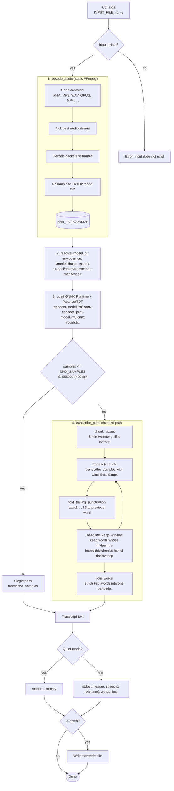
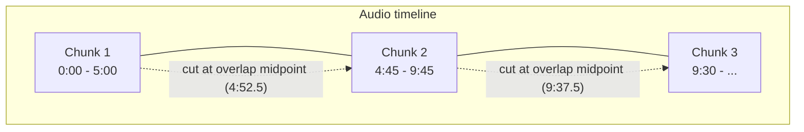

# Transcriber

Offline speech-to-text CLI written in Rust, built on the NVIDIA Parakeet TDT 0.6B v3 model via `parakeet-rs` and statically linked FFmpeg.

| Binary | Source | Model | Description |
| :--- | :--- | :--- | :--- |
| `transcribe` | `src/transcribe.rs` | NVIDIA Parakeet TDT 0.6B v3 | Batch speech recognition with automatic chunking for long audio |

---

## Architecture

- **Static FFmpeg linking**: Decoders and resamplers are statically compiled into the binary via `ffmpeg-sys-next`. No system `ffmpeg` binary or dynamic library installation is required at runtime.
- **Local model evaluation**: ONNX models run locally via ONNX Runtime without network access or disk writes to `~/.cache`.
- **Automatic model download**: A build script (`scripts/build.rs`) downloads required model weights on first build if they are not already present in `models/`.
- **Long audio chunking**: The Parakeet TDT encoder cannot attend over more than about 5000 encoder steps (about 400 seconds) per call. Longer audio is split into overlapping windows and stitched back together.

### `transcribe` pipeline



#### Stages

| Stage | Function | What it does |
| :--- | :--- | :--- |
| 1. Decode | `decode_audio` | FFmpeg demuxes, decodes and resamples any supported container to 16 kHz mono `f32` PCM held in memory |
| 2. Locate model | `resolve_model_dir` | Finds `models/basic` without touching `~/.cache` or the network |
| 3. Load model | `ParakeetTDT::from_pretrained` | Builds ONNX Runtime sessions for the encoder and decoder/joint graphs |
| 4. Transcribe | `transcribe_pcm` | One pass for short audio, overlapping chunks for long audio |
| 5. Output | `main` | Prints text (and metrics unless `-q`), optionally writes `-o` file |

#### Chunking details

The exported encoder uses a fixed relative-position table of 9999 entries, centered at 5000. Attention adds a slice of that table onto scores that are `2 * steps - 1` wide, so the add only broadcasts while `steps <= 5000`. At 16 kHz with a 160-sample hop and 8x subsampling, 6,400,000 samples is exactly 5000 steps; one hop more fails.

| Constant | Value | Purpose |
| :--- | :--- | :--- |
| `MAX_SAMPLES` | 6,400,000 (400 s) | Longest input sent in a single pass |
| `CHUNK_SAMPLES` | 4,800,000 (5 min) | Window length, safely under the limit |
| `OVERLAP_SAMPLES` | 240,000 (15 s) | Shared audio between neighboring windows |



Each cut sits in the middle of the overlap. A word is kept by the chunk that contains its midpoint, so every word is emitted exactly once and was always heard with at least 7.5 seconds of context on both sides. The first chunk keeps everything from the start and the last chunk keeps everything to the end.

---

## Prerequisites

Building from source requires:

1. **Rust 1.80+** and **Cargo**:
   ```bash
   rustc --version
   cargo --version
   ```

2. **FFmpeg development libraries** (compile-time only):
   - macOS:
     ```bash
     brew install ffmpeg
     ```
   - Linux (Debian/Ubuntu):
     ```bash
     sudo apt install -y libavcodec-dev libavformat-dev libavutil-dev libswresample-dev
     ```

---

## Building and Installation

### 1. Build release binary

Cargo executes `scripts/build.rs` to verify or download model files to `models/`, then compiles the binary:

```bash
cargo build --release
```

The compiled executable is located at `target/release/transcribe`.

To check or download models without building the CLI binary:

```bash
cargo run --bin download-models
```

### 2. Export system-wide

Run `export.sh` to install the binary to `~/.local/bin` (or pass a custom installation directory):

```bash
./export.sh
```

### 3. Run tests

Unit tests live in `src/transcribe_tests.rs`:

```bash
cargo test --bin transcribe
```

---

## Usage

```bash
# Basic transcription
transcribe audio.mp3

# Save transcript to file
transcribe audio.opus -o transcript.txt

# Quiet mode (stdout contains only transcribed text)
transcribe audio.m4a -q
transcribe audio.wav -q | pbcopy
```

Long recordings (for example a 48 minute lecture) work the same way; chunking is automatic.

### Options

```
Usage: transcribe [OPTIONS] <INPUT_FILE>

Arguments:
  <INPUT_FILE>                 Path to the audio or video file to transcribe

Options:
  -o, --output <OUTPUT_FILE>   Optional output file path to save the transcription
  -q, --quiet                  Only output the transcribed text, suppressing metrics
  -h, --help                   Print help
  -V, --version                Print version
```

---

## Repository Layout

```
.
├── Cargo.toml               # Cargo package configuration
├── README.md                # Project documentation
├── AGENTS.md                # Agent guidelines and project structure notes
├── export.sh                # Installation script for ~/.local/bin
├── start.sh                 # Local launcher script
├── audio/                   # Sample audio files for testing
├── models/
│   └── basic/               # Parakeet TDT 0.6B ONNX assets
│       ├── vocab.txt
│       ├── decoder_joint-model.int8.onnx
│       └── encoder-model.int8.onnx
├── src/
│   ├── transcribe.rs        # CLI, decoding, chunked transcription pipeline
│   └── transcribe_tests.rs  # Unit tests for chunking and stitching
└── scripts/
    ├── build.rs             # Cargo build script for checking/downloading models
    └── download_models.rs   # Standalone runner for model downloading
```
