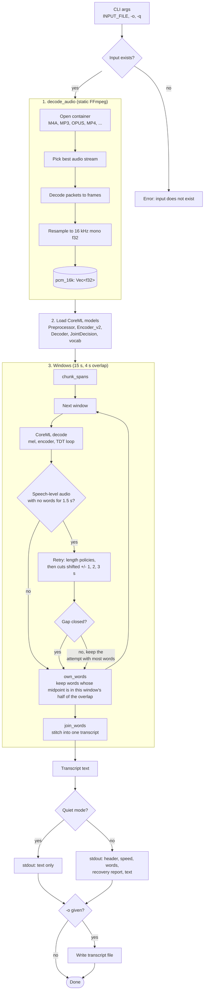

# Transcriber

Offline speech-to-text CLI for macOS, written in Rust. It runs NVIDIA Parakeet TDT 0.6B v3 on Apple's CoreML (Neural Engine, GPU and CPU) and decodes audio with statically linked FFmpeg.

| Binary | Source | Model |
| :--- | :--- | :--- |
| `transcribe` | `src/transcribe.rs`, `src/coreml.rs` | NVIDIA Parakeet TDT 0.6B v3, CoreML export by FluidInference |

macOS only (Apple Silicon recommended).

---

## Architecture

- **CoreML inference**: the preprocessor, encoder, decoder and joint network run through the `coreml` crate. The TDT decode loop is written in Rust (`src/coreml.rs`).
- **Static FFmpeg linking**: decoders and resamplers are compiled into the binary via `ffmpeg-sys-next`. No system `ffmpeg` is needed at runtime.
- **Local models only**: weights load from `models/coreml/` on disk. No network access or `~/.cache` writes at runtime.
- **Automatic model download**: `scripts/build.rs` downloads and verifies the CoreML weights on first build.

### Why every window is checked

The CoreML encoder has a fixed 15 second input, so audio is split into overlapping 15 second windows. Parakeet TDT v3 also has input cuts on which the joint network never beats blank, so a window of clear speech can decode to nothing (FluidAudio issue 909). This is a property of the model, not of CoreML: the ONNX build of the model blanked on the same isolated cut. Without any checks, a test file lost about 16% of its words.

So `transcribe` checks every window against the audio. A window is suspicious when a stretch of at least 1.5 seconds with speech-level energy contains no words. A suspicious window is retried until a result has no gap:

1. **Length policies**: decode again with perturbed length declarations (declare the audio 0.2 s shorter, declare the whole window valid to the preprocessor or the encoder, and combinations). A retry is only trusted when it emits at least 2 tokens with mean confidence of 0.7 or more.
2. **Shifted cuts**: decode the window again with its start shifted by -1, +1, -2, +2, -3 and +3 seconds, trying the actual length and every length policy for each cut.

The checks only add text where the model produced none. Words the model did produce are never edited or removed, apart from overlap stitching (each word is kept by exactly one window). If a window still has a gap after every attempt, the attempt with the most words is kept and the run reports it.

### `transcribe` pipeline



#### CoreML models

Four bundles from [FluidInference/parakeet-tdt-0.6b-v3-coreml](https://huggingface.co/FluidInference/parakeet-tdt-0.6b-v3-coreml) live in `models/coreml/`:

| Model | Input | Output | Notes |
| :--- | :--- | :--- | :--- |
| `Preprocessor.mlmodelc` | audio `[1, 240000]`, length | mel `[1, 128, 1501]` | 15 s fixed window, zero padded |
| `Encoder_v2.mlmodelc` | mel, mel length | encoder `[1, 1024, 188]` | int8 per-channel; the original palettized encoder mangles words near window edges (FluidAudio issue 760) |
| `Decoder.mlmodelc` | last token, LSTM state `[2, 1, 640]` | decoder step, new state | prediction network |
| `JointDecision.mlmodelc` | encoder step, decoder step | token, probability, duration | single-step argmax joint |

The TDT loop walks the encoder frames. At each frame the joint predicts a token and a duration. A non-blank token is emitted and advances the decoder state; the duration says how many frames to skip.

#### Windowing

| Constant | Value | Purpose |
| :--- | :--- | :--- |
| `COREML_WINDOW_SAMPLES` | 240,000 (15 s) | Fixed encoder input |
| `COREML_OVERLAP_SAMPLES` | 64,000 (4 s) | Audio shared by neighbouring windows |
| `GAP_SECS` | 1.5 s | Speech-level audio with no words that counts as a gap |
| `SHIFTS_SECS` | -1, 1, -2, 2, -3, 3 | Cut shifts tried when a window still has a gap |

Each cut sits in the middle of the overlap. A word is kept by the window that contains its midpoint, so every word is emitted once and was heard with at least 2 seconds of context on both sides.

---

## Performance

Measured on an Apple Silicon Mac (10 cores, 32 GB RAM), release build, one run, on `audio/sociallifeincamstarrzapata_13_gonzalez_64kb.mp3` (19 min 42 s).

| Result | Value |
| :--- | :--- |
| Wall time | 41 s |
| Speed | 28.7x real time |
| Peak memory | 1.2 GB |
| Words | 2,940 |
| Windows needing recovery | 35 of about 108, all recovered |
| Windows still incomplete | 0 |

For context, measured before the ONNX build was removed from this project:

- The ONNX build with 5 minute chunks took 54 to 68 s, peaked at 5.1 GB and produced 2,626 words.
- CoreML with no checks took 11.6 s but produced only 2,201 words, because blank windows went unnoticed.
- CoreML with recovery (using ONNX for the hardest windows) was about 92% similar to the ONNX-only transcript. The differences were mostly small wording variants ("13" against "thirteen", "Zapata" against "Sapata"), and each side had a few sentences the other lacked. The ONNX 5 minute chunks themselves silently dropped about 300 words of real speech.

The first run after a model change is slower, because CoreML specialises the models for the Neural Engine and caches the result. A 21 second note took about 15 s the first time and 0.4 s afterwards.

---

## Prerequisites

1. **macOS 13 or newer**, Apple Silicon recommended.
2. **Rust 1.80+** and **Cargo**.
3. **Xcode 15+ with the Swift toolchain**: the `coreml` crate compiles a small Swift bridge during `cargo build`. The binary links the system Swift runtime from `/usr/lib/swift`.
4. **FFmpeg development libraries** (compile time only):
   ```bash
   brew install ffmpeg
   ```

---

## Building and Installation

### 1. Build the release binary

Cargo runs `scripts/build.rs`, which verifies or downloads the CoreML model files (about 0.65 GB), then compiles:

```bash
cargo build --release
```

The executable is `target/release/transcribe`. To check or download models without building:

```bash
cargo run --bin download-models
```

### 2. Export system-wide

`export.sh` installs the binary to `~/.local/bin` (or a directory you pass):

```bash
./export.sh
```

### 3. Run tests

Unit tests live in `src/transcribe_tests.rs` (windowing and stitching) and `src/coreml_tests.rs` (CoreML word assembly and gap detection):

```bash
cargo test --bin transcribe
```

---

## Usage

```bash
# Basic transcription
transcribe audio.mp3

# Save transcript to file
transcribe audio.opus -o transcript.txt

# Quiet mode (stdout contains only transcribed text)
transcribe audio.m4a -q
transcribe audio.mp3 -q | pbcopy
```

Long recordings work without any flag; windowing and recovery are automatic.

### Options

```
Usage: transcribe [OPTIONS] <INPUT_FILE>

Arguments:
  <INPUT_FILE>                 Path to the audio or video file to transcribe

Options:
  -o, --output <OUTPUT_FILE>   Optional output file path to save the transcription
  -q, --quiet                  Only output the transcribed text, suppressing metrics
  -h, --help                   Print help
  -V, --version                Print version
```

---

## Repository Layout

```
.
├── Cargo.toml               # Cargo package configuration
├── README.md                # Project documentation
├── AGENTS.md                # Agent guidelines and project structure notes
├── export.sh                # Installation script for ~/.local/bin
├── start.sh                 # Local launcher script
├── audio/                   # Sample audio files for testing
├── models/
│   └── coreml/              # Parakeet TDT 0.6B v3 CoreML bundles
│       ├── Preprocessor.mlmodelc/
│       ├── Encoder_v2.mlmodelc/
│       ├── Decoder.mlmodelc/
│       ├── JointDecision.mlmodelc/
│       └── parakeet_v3_vocab.json
├── src/
│   ├── transcribe.rs        # CLI, decoding, windowing, recovery and stitching
│   ├── coreml.rs            # CoreML engine: models, TDT decode loop, word assembly
│   ├── transcribe_tests.rs  # Tests for windowing and stitching
│   └── coreml_tests.rs      # Tests for CoreML word assembly and gap detection
└── scripts/
    ├── build.rs             # Cargo build script for checking/downloading models
    └── download_models.rs   # Standalone runner for model downloading
```
