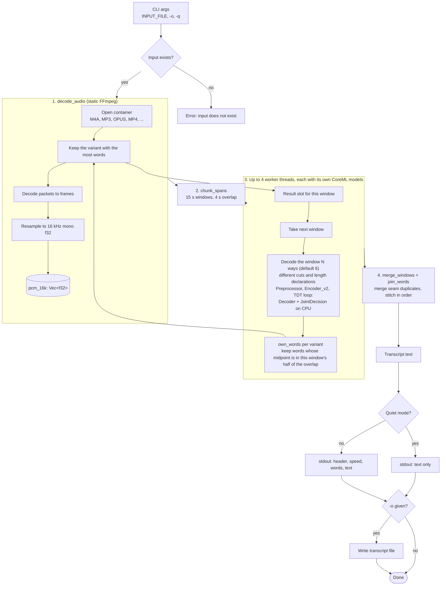

# Transcriber

Offline speech-to-text CLI for macOS, written in Rust. It runs NVIDIA Parakeet TDT 0.6B v3 on Apple's CoreML (Neural Engine, GPU and CPU) and decodes audio with statically linked FFmpeg.

| Binary | Source | Model |
| :--- | :--- | :--- |
| `transcribe` | `src/transcribe.rs`, `src/coreml.rs` | NVIDIA Parakeet TDT 0.6B v3, CoreML export by FluidInference |

macOS only (Apple Silicon recommended).

---

## Architecture

- **CoreML inference**: the preprocessor, encoder, decoder and joint network run through the `coreml` crate. The encoder runs on the Neural Engine, GPU and CPU as CoreML chooses. The decoder and joint network are tiny and called thousands of times, so they are pinned to the CPU, where they avoid Neural Engine dispatch latency. The TDT decode loop is written in Rust (`src/coreml.rs`).
- **Parallel windows**: up to 4 worker threads decode windows at the same time, each with its own copy of the models. The weights are memory-mapped, so this costs little RAM, and the output is identical to a single thread.
- **Static FFmpeg linking**: decoders and resamplers are compiled into the binary via `ffmpeg-sys-next`. No system `ffmpeg` is needed at runtime.
- **Local models only**: weights load from `models/coreml/` on disk. No network access or `~/.cache` writes at runtime.
- **Automatic model download**: `scripts/build.rs` downloads and verifies the CoreML weights on first build.

### Why every window is decoded several ways

The CoreML encoder has a fixed 15 second input, so audio is split into overlapping 15 second windows. Parakeet TDT v3 also has input cuts on which the joint network never beats blank, so a window of clear speech can decode to nothing (FluidAudio issue 909). It is a property of the model, not of CoreML: the ONNX build blanked on the same isolated cut. Decoded once, a 19 minute test file lost about a quarter of its words.

The output also depends on small input details, so a cut that blanks one way often works another way. Every window is therefore decoded several ways, and the result with the most words is kept:

| # | Cut | Declared length |
| :--- | :--- | :--- |
| 1 | normal | true length |
| 2 | normal | 0.2 s shorter |
| 3 | 1 s earlier | true length |
| 4 | normal | 0.2 s shorter, whole mel length valid to the encoder |
| 5 | 1 s later | true length |
| 6 | normal | 0.2 s shorter, whole window valid to the preprocessor |
| 7 to 12 | 2 s earlier, 2 s later, 1 s earlier and 1 s later with the shorter length, 3 s earlier, 3 s later | |

`--variants N` chooses how many of these are used (1 to 12, default 6).

This is deliberately free of assumptions about the audio. Every window is decoded every time, with no energy or silence test deciding what to skip, and the choice between variants compares only the model's own outputs. A blank variant has no words and loses to one that has some. No word is ever edited: each window's result is one complete model output.

The cost of more variants is time (about 3.4 s each on the 19 minute file) and, past about 6, hallucination risk. Choosing the result with the most words can also pick an invented one. At 12 variants the test file gained real passages that 6 missed, and also three invented phrases such as "the American American American as Laredo". At 6 none were found, which is why 6 is the default. Windows that blank under every variant are still lost, so the transcript can still miss some text.

Overlap stitching is the only other post-processing. Each word is kept by exactly one window, and a word that both neighbouring windows kept at a seam (same word, timed within 0.25 s) is merged into one. A real repetition such as "the the" is spoken later than that and is kept.

### `transcribe` pipeline



#### CoreML models

Four bundles from [FluidInference/parakeet-tdt-0.6b-v3-coreml](https://huggingface.co/FluidInference/parakeet-tdt-0.6b-v3-coreml) live in `models/coreml/`:

| Model | Input | Output | Notes |
| :--- | :--- | :--- | :--- |
| `Preprocessor.mlmodelc` | audio `[1, 240000]`, length | mel `[1, 128, 1501]` | 15 s fixed window, zero padded |
| `Encoder_v2.mlmodelc` | mel, mel length | encoder `[1, 1024, 188]` | int8 per-channel; the original palettized encoder mangles words near window edges (FluidAudio issue 760) |
| `Decoder.mlmodelc` | last token, LSTM state `[2, 1, 640]` | decoder step, new state | prediction network |
| `JointDecision.mlmodelc` | encoder step, decoder step | token, probability, duration | single-step argmax joint |

The TDT loop walks the encoder frames. At each frame the joint predicts a token and a duration. A non-blank token is emitted and advances the decoder state; the duration says how many frames to skip.

#### Windowing

| Constant | Value | Purpose |
| :--- | :--- | :--- |
| `COREML_WINDOW_SAMPLES` | 240,000 (15 s) | Fixed encoder input |
| `COREML_OVERLAP_SAMPLES` | 64,000 (4 s) | Audio shared by neighbouring windows |
| `DEFAULT_VARIANTS` / `VARIANTS` | 6 of 12 | Ways each window is decoded (`--variants`) |
| `MAX_WINDOW_THREADS` | 4 | Windows decoded at once |
| `SEAM_DUPLICATE_SECS` | 0.25 s | Same word at a seam within this time is one word |

Each cut sits in the middle of the overlap. A word is kept by the window that contains its midpoint, so every word is emitted once and was heard with at least 2 seconds of context on both sides.

---

## Performance

Measured on an Apple Silicon Mac (10 cores, 32 GB RAM), release build, on `audio/sociallifeincamstarrzapata_13_gonzalez_64kb.mp3` (19 min 42 s). Two consecutive runs gave 21.4 s wall time both times.

| Result | Value |
| :--- | :--- |
| Decode time | 20.9 s |
| Speed | 56x real time |
| Peak memory | 0.25 GB |
| Words | 2,911 |
| Immediate repeated words | 2, both real ("had had", "ours, ours") |

Effect of `--variants` (one run each, warm models):

| Variants | Time | Words | Notes |
| :--- | :--- | :--- | :--- |
| 1 | 4.2 s | 2,193 | each window decoded once; blank windows lose about a quarter of the words |
| 2 | 7.7 s | 2,564 | |
| 3 | 11.1 s | 2,875 | |
| 6 (default) | 21.3 s | 2,911 | no invented phrases found |
| 8 | 28.2 s | 2,961 | invented phrases appear |
| 12 | 41.8 s | 2,981 | recovers more real passages, plus three invented phrases |

Choosing between variants by the model's own token confidence instead of by word count made no measurable difference: the invented phrases are high-confidence too.

How the per-variant cost was reduced (same file, one run each):

| Step | Time (1 variant) | Change |
| :--- | :--- | :--- |
| One thread, everything on default compute units | 24.4 s | |
| Decoder and joint pinned to the CPU | 21.6 s | the decoder's 7.2 s became 3.7 s |
| 4 threads, one copy of the models each | 9.8 s | identical output |
| Current (windows decoded once, `--variants 1`) | 4.2 s | each extra variant adds about 3.4 s |

What did not help or was not worth it:

- **Joint network on the CPU, GPU or Neural Engine**: about 6 s in every case. Its cost is per-call overhead, not compute.
- **Decoder on the GPU**: no better than the CPU.
- **More than 4 threads**: the Neural Engine runs the encoder one window at a time, so it becomes the limit.
- **Longer windows**: not possible. Every CoreML encoder in the model repository takes exactly 15 seconds.

For context, measured with earlier versions of this project:

- The ONNX build with 5 minute chunks took 54 to 68 s, peaked at 5.1 GB and produced 2,626 words. Its own long chunks silently dropped about 300 words of real speech.
- An earlier CoreML design that detected blank windows from audio energy and retried only those took 6.5 s and produced 2,927 words. It was removed because deciding what to retry from the audio is an assumption about where speech is.

The first run after a model change is slower, because CoreML specialises the models for the Neural Engine and caches the result. A 21 second note took about 15 s the first time and 0.8 s afterwards.

---

## Prerequisites

1. **macOS 13 or newer**, Apple Silicon recommended.
2. **Rust 1.80+** and **Cargo**.
3. **Xcode 15+ with the Swift toolchain**: the `coreml` crate compiles a small Swift bridge during `cargo build`. The binary links the system Swift runtime from `/usr/lib/swift`.
4. **FFmpeg development libraries** (compile time only):
   ```bash
   brew install ffmpeg
   ```

---

## Building and Installation

### 1. Build the release binary

Cargo runs `scripts/build.rs`, which verifies or downloads the CoreML model files (about 0.65 GB), then compiles:

```bash
cargo build --release
```

The executable is `target/release/transcribe`. To check or download models without building:

```bash
cargo run --bin download-models
```

### 2. Export system-wide

`export.sh` installs the binary to `~/.local/bin` (or a directory you pass):

```bash
./export.sh
```

### 3. Run tests

Unit tests live in `src/transcribe_tests.rs` (windowing and stitching) and `src/coreml_tests.rs` (CoreML word assembly):

```bash
cargo test --bin transcribe
```

---

## Usage

```bash
# Basic transcription
transcribe audio.mp3

# Save transcript to file
transcribe audio.opus -o transcript.txt

# Quiet mode (stdout contains only transcribed text)
transcribe audio.m4a -q
transcribe audio.mp3 -q | pbcopy
```

Long recordings work without any flag; windowing is automatic. To trade time for completeness, change how many ways each window is decoded:

```bash
transcribe lecture.mp3 --variants 3   # faster, about 11 s per 20 minutes
transcribe lecture.mp3 --variants 12  # fullest, about 42 s per 20 minutes, some invented phrases
```

### Options

```
Usage: transcribe [OPTIONS] <INPUT_FILE>

Arguments:
  <INPUT_FILE>                 Path to the audio or video file to transcribe

Options:
  -o, --output <OUTPUT_FILE>   Optional output file path to save the transcription
  -q, --quiet                  Only output the transcribed text, suppressing metrics
      --variants <N>           Ways each 15 s window is decoded, 1 to 12 [default: 6]
  -h, --help                   Print help
  -V, --version                Print version
```

---

## Repository Layout

```
.
├── Cargo.toml               # Cargo package configuration
├── README.md                # Project documentation
├── AGENTS.md                # Agent guidelines and project structure notes
├── export.sh                # Installation script for ~/.local/bin
├── start.sh                 # Local launcher script
├── audio/                   # Sample audio files for testing
├── models/
│   └── coreml/              # Parakeet TDT 0.6B v3 CoreML bundles
│       ├── Preprocessor.mlmodelc/
│       ├── Encoder_v2.mlmodelc/
│       ├── Decoder.mlmodelc/
│       ├── JointDecision.mlmodelc/
│       └── parakeet_v3_vocab.json
├── src/
│   ├── transcribe.rs        # CLI, decoding, windowing, variants, threads and stitching
│   ├── coreml.rs            # CoreML engine: models, TDT decode loop, word assembly
│   ├── transcribe_tests.rs  # Tests for windowing and stitching
│   └── coreml_tests.rs      # Tests for CoreML word assembly
└── scripts/
    ├── build.rs             # Cargo build script for checking/downloading models
    └── download_models.rs   # Standalone runner for model downloading
```
